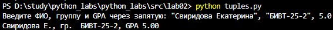

# python_labs

# Лабораторная работа №1

## задание 1

name = str(input("Имя: "))
age = int(input("Возраст: "))
print("Привет, ", name, "! Через год тебе будет ", age+1, ".",sep = '')

(./images/lab01/ex01.png)

## задание 2
a = float(input("a:"))
b = float(input("b:"))
sum = a+b
print("sum=", sum , "avg=", sum/2)
(./images/lab01/ex02.png)

# Лабораторная работа 2
## задание 1

## задание 3

