# python_labs

# Лабораторная работа №1

## задание 1
```python
name = str(input("Имя: "))
age = int(input("Возраст: "))
print("Привет, ", name, "! Через год тебе будет ", age+1, ".",sep = '')
```

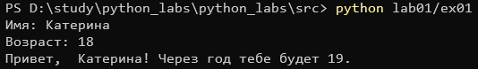

## задание 2
```python
a = float(input("a:"))
b = float(input("b:"))
sum = a+b
print("sum=", sum , "avg=", sum/2)
```

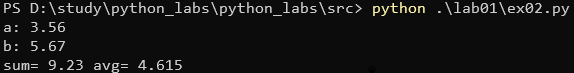

## задание 3
```python
price = float(input())
discount = float(input())
vat = float(input())
base =  price * (1 - discount/100)
print("База после скидки:  ", base, "₽")
print("НДС:                ", base * (vat/100), "₽")
print("Итого к оплате:     ", base+ base * (vat/100), "₽")
```

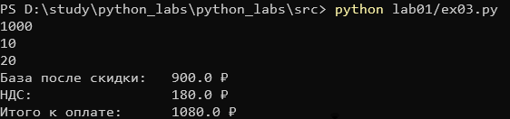

## задание 4
```python
m = int(input("Минуты: "))
h = m // 60
min = m % 60
print(f"{h}:{min:02d}")
```

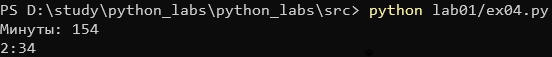

## задание 5
```python
fio = str(input("ФИО:"))
FIO = fio.title().split()
surname = FIO[0]; name = FIO[1]; fname = FIO[2]
length = len(surname) + len(name) + len(fname) + 2
print("Инициалы: ", surname[0], name[0], fname[0], sep = '')
print("Длина (символов):", length)
```

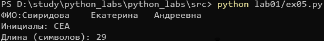

## задание 6
```python
N = int(input("Число строк:"))
o = 0; z = 0
for i in range(N):
    member = str(input()).split()
    q = member[3]
    if q == "True":
        o = o + 1
    if q == "False": 
        z = z + 1
print(o,z)
```

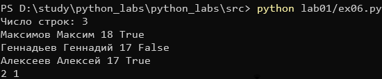

## задание 6
```python
sh = input()

start = -1
for i, ch in enumerate(sh):
    if ch.isupper():
        start = i
        break

second = start
for i in range(len(sh) - 1):
    if sh[i].isdigit() and sh[i+1].isalpha():
        second = i + 1
        break

step = second - start

result = []
i = start
while i < len(sh):
    result.append(sh[i])
    i += step

result = ''.join(result)
print(result)
```

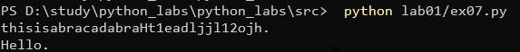


# Лабораторная работа 2
## задание 1: arrays
```python
def min_max(nums: list[float | int]) -> tuple[float | int, float | int]:
    if not nums:
        raise ValueError("пустой список")

    return (min(nums), max(nums))

def unique_sorted(nums: list[float | int]) -> list[float | int]:
    unums = []
    for num in nums:
        if num not in unums:
            unums.append(num)
    unums.sort()
    return unums

def flatten(mat: list[list | tuple]) -> list:
    truenums = []
    for element in mat:
        if not isinstance(element, (list, tuple)):
            raise TypeError(f"элемент {element} не является списком или кортежем")
        truenums.extend(element)
    return truenums
```
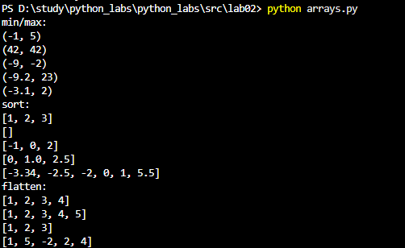

## задание 2: matrix
```python
def transpose(mat: list[list[float | int]]) -> list[list]:
    # Проверка, что матрица не пустая
    if not mat:
        return []
    
    # Проверка, что все элементы - списки
    if not all(isinstance(row, list) for row in mat):
        raise TypeError("Все элементы должны быть списками")
    
    # Проверка на прямоугольность
    length = len(mat[0])
    for row in mat:
        if length != len(row):
            raise ValueError("рваная матрица")
    
    rows = len(mat)
    cols = length
    
    # Создаём транспонированную матрицу
    tr_mat = []
    for _ in range(cols):
        tr_mat.append([0] * rows)
    
    # Заполняем транспонированную матрицу
    for i in range(rows):
        for j in range(cols):
            tr_mat[j][i] = mat[i][j]
    
    return tr_mat


def row_sums(mat: list[list[float | int]]) -> list[float]:
    # Проверка на пустую матрицу
    if not mat:
        return []
    
    # Проверка, что все элементы - списки
    if not all(isinstance(row, list) for row in mat):
        raise TypeError("Все элементы должны быть списками")
    
    # Проверка на прямоугольность
    length = len(mat[0])
    for row in mat:
        if length != len(row):
            raise ValueError("рваная матрица")
    
    return [sum(row) for row in mat]


def col_sums(mat: list[list[float | int]]) -> list[float]:
    # Проверка на пустую матрицу
    if not mat:
        return []
    
    # Проверка, что все элементы - списки
    if not all(isinstance(row, list) for row in mat):
        raise TypeError("Все элементы должны быть списками")
    
    # Проверка на прямоугольность
    length = len(mat[0])
    for row in mat:
        if length != len(row):
            raise ValueError("рваная матрица")
    
    num_cols = length
    result = [0] * num_cols
    
    for row in mat:
        for i, val in enumerate(row):
            result[i] += val
    
    return result   
```
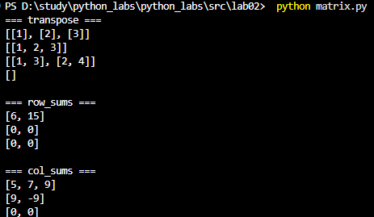 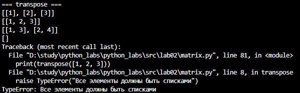 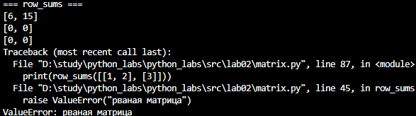


## задание 3: tuples
```python
def format_record(rec: tuple[str, str, float]) -> str:
    fio, group, gpa = rec
    if not fio:
        raise ValueError("empty fio")
    if not group:
        raise ValueError("empty group")
    if not isinstance(gpa, (int, float)):
        raise TypeError("incorrect GPA")

    # разделяем ФИО (убираем все пробелы)
    fio_parts = " ".join(fio.split()).split()

    # заглавная буква для фамилии
    fio_parts[0] = fio_parts[0].capitalize()

    # инициалы (в верхнем регистре), и для ФИО, и для ФИ
    if len(fio_parts) >= 3:
        initials = f"{fio_parts[1][0].upper()}.{fio_parts[2][0].upper()}."
    elif len(fio_parts) == 2:
        initials = f"{fio_parts[1][0].upper()}."

    # записываем все в format_change (группу и GPA тоже))
    format_change = f"{fio_parts[0]} {initials}, гр. {group}, GPA {gpa:.2f}"

    return format_change


task = input("Введите ФИО, группу и GPA через запятую: ")
fio, group, gpa = task.split(",")
gpa = float(gpa)
fio = fio.replace('"', '')
group = group.replace('"', '')
print(format_record((fio, group, gpa)))
```
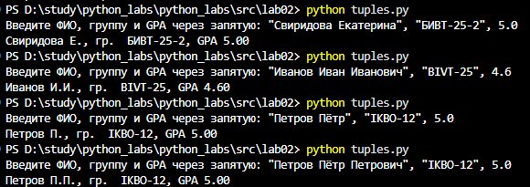 

# Лабораторная работа 3
## задание 1: text.py
```python
from pathlib import Path
import csv
from typing import Iterable, Sequence

def read_text(path: str | Path, encoding: str = "utf-8") -> str:

    """
    Открыть файл на чтение в указанной кодировке и вернуть содержимое как одну строку.
    Если файл не найден — FileNotFoundError.
    Если кодировка не подходит — UnicodeDecodeError.
    path: путь к файлу.
    encoding: кодировка файла (по умолчанию "utf-8")
        изменить кодировку: encoding="cp1251"
    """

    p = Path(path)
    # FileNotFoundError и UnicodeDecodeError пусть «всплывают» — это нормально
    return p.read_text(encoding=encoding)

def write_csv(rows: Iterable[Sequence], path: str | Path, header: tuple[str, ...] | None = None) -> None:

    """
    Создать/перезаписать CSV с разделителем ','.
    header будет записан первой строкой.
    Проверка на одинаковую длину строк (иначе ValueError).
    """

    p = Path(path)
    rows = list(rows)

    if rows:
        row_length = len(rows[0])
        for row in rows:
            if len(row) != row_length:
                raise ValueError("Все строки должны иметь одинаковую длину.")
    
    with p.open("w", newline="", encoding="utf-8") as f:
        w = csv.writer(f)
        if header is not None:
            w.writerow(header)
        for r in rows:
            w.writerow(r)

def ensure_parent_dir(path: str | Path) -> None:
    """Создать родительские директории, если их нет."""
    Path(path).parent.mkdir(parents=True, exist_ok=True)

if __name__ == "__main__":
    
    from io_txt_csv import read_text, write_csv
    write_csv([("word", "count"), ("test", 3)], "data/result.csv")
    try:
        txt = read_text("data\lab04\input.txt")
        print("Файл успешно прочитан")
    except FileNotFoundError:
        print("Файл input.txt не найден")
    except UnicodeDecodeError:
        print("Ошибка кодировки при чтении файла")
```
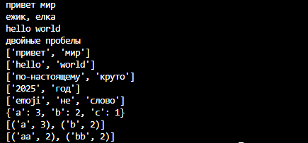

## задание 2: text_stats.py
```python
import argparse
import sys
from pathlib import Path

from io_txt_csv import read_text, write_csv
from lib.text import normalize, tokenize, count_freq, top_n

def create_report(input_path: str, output_path: str, encoding: str = "utf-8") -> None:

    """
    Читает входной файл data/lab04/input.txt
    Нормализует, токенизирует и считает частоты слов, используя функции из ЛР3 (lib/text.py)
    Сохраняет data/report.csv c колонками: word,count (отсортированными: count ↓, слово ↑)
    В консоль печатает:
        - кол-во всех слов
        - кол-во уникальных слов
        - топ-5 слов

    Примеры запуска:
        python src/lab04/text_report.py
        python src/lab04/text_report.py --in data/lab04/input.txt --out data/output.csv
        python src/lab04/text_report.py --in data/lab04/input.txt --encoding cp1251

    Если data/input.txt не существует → print() и sys.exit(1)
    Пустой вход → report.csv будет содержать только заголовок.
    Нестандартная кодировка → укажите, как передать --encoding cp1251.
    """

    try:
        text = read_text(input_path, encoding)
    except FileNotFoundError:
        print(f"Ошибка: файл {input_path} не найден.")
        sys.exit(1)
    except UnicodeDecodeError as e:
        print(f"Ошибка: укажите другую кодировку.")
        sys.exit(1)

    normalized_text = normalize(text)
    tokens = tokenize(normalized_text)
    freq = count_freq(tokens)
    total_words = len(tokens)
    unique_words = len(set(tokens))
    top5 = top_n(freq, 5)

    sorted_data = sorted(freq.items(), key=lambda item: (-item[1], item[0]))
    header = ("word", "count")

    write_csv(sorted_data, output_path, header)
    print(f"Всего слов: {total_words}")
    print(f"Уникальных слов: {unique_words}")
    print("Топ-5:")
    for word, count in top5:
        print(f"{word}: {count}")

def main():
    parser = argparse.ArgumentParser(description="Отчёт о частоте слов из текстового файла.")
    parser.add_argument("--in", dest="input_file", help="Путь к входному текстовому файлу.", default="data/lab04/input.txt")
    parser.add_argument("--out", dest="output_file", help="Путь к выходному CSV файлу.", default="data/lab04/report.csv")
    parser.add_argument("--encoding", default="utf-8", )
    args = parser.parse_args()
    create_report(args.input_file, args.output_file, args.encoding)

if __name__ == "__main__":
    main()
```
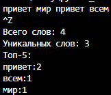


# Лабораторная работа 4
## задание 1: io_txt_csv.py
```python
from pathlib import Path
import csv
from typing import Iterable, Sequence


def read_text(path: str | Path, encoding: str = "utf-8") -> str:
    """Прочитать файл целиком как одну строку.

    FileNotFoundError и UnicodeDecodeError не подавляются.
    Если кодировка не utf-8 — укажите явно, например: read_text("f.txt", encoding="cp1251").
    """
    return Path(path).read_text(encoding=encoding)


def write_csv(rows: Iterable[Sequence], path: str | Path,
              header: tuple[str, ...] | None = None) -> None:
    """Записать CSV с разделителем ','.

    Если передан header — пишется первой строкой.
    Все строки должны быть одинаковой длины, иначе ValueError.
    """
    rows = list(rows)

    if rows:
        n = len(rows[0])
        for r in rows:
            if len(r) != n:
                raise ValueError("Все строки должны иметь одинаковую длину.")

    p = Path(path)
    with p.open("w", newline="", encoding="utf-8") as f:
        w = csv.writer(f)
        if header is not None:
            w.writerow(header)
        for r in rows:
            w.writerow(r)


def ensure_parent_dir(path: str | Path) -> None:
    """Создать родительские директории, если их нет."""
    Path(path).parent.mkdir(parents=True, exist_ok=True)
```
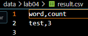 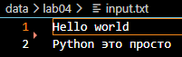 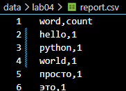

## задание 2: text_report.py
```python

import sys
from pathlib import Path

import argparse
from collections import Counter

from src.lab04.io_txt_csv import read_text, write_csv, ensure_parent_dir
from src.lib.text import normalize, tokenize, count_freq, top_n


def collect_frequencies(input_paths: list[str], encoding: str = "utf-8") -> Counter:
    """Прочитать все файлы, вернуть суммарные частоты слов."""
    total: Counter = Counter()
    for path in input_paths:
        try:
            text = read_text(path, encoding)
        except FileNotFoundError:
            print(f"Ошибка: файл {path} не найден.")
            sys.exit(1)
        except UnicodeDecodeError:
            print(f"Ошибка: файл {path} — укажите другую кодировку (--encoding).")
            sys.exit(1)

        tokens = tokenize(normalize(text))
        total.update(count_freq(tokens))
    return total


def create_report(input_paths: list[str], output_path: str,
                  encoding: str = "utf-8") -> None:
    """Считать частоты из одного/нескольких файлов и записать CSV.

    В консоль печатает: число файлов, всего слов, уникальных, топ-5.
    """
    freq = collect_frequencies(input_paths, encoding)

    total_words = sum(freq.values())
    unique_words = len(freq)
    top5 = top_n(freq, 5)

    rows = sorted(freq.items(), key=lambda kv: (-kv[1], kv[0]))

    ensure_parent_dir(output_path)
    write_csv(rows, output_path, header=("word", "count"))

    print(f"Файлов обработано: {len(input_paths)}")
    print(f"Всего слов: {total_words}")
    print(f"Уникальных слов: {unique_words}")
    print("Топ-5:")
    for word, count in top5:
        print(f"  {word}: {count}")
    print(f"Записано: {output_path}")


def main() -> None:
    parser = argparse.ArgumentParser(
        description="Отчёт о частоте слов из текстовых файлов."
    )
    parser.add_argument(
        "--in", dest="input_files", nargs="+",
        default=["data/lab04/input.txt","data/lab04/a.txt","data/lab04/b.txt"],
        help="Один или несколько входных .txt файлов."
    )
    parser.add_argument(
        "--out", dest="output_file",
        default="data/lab04/report.csv",
        help="Путь к выходному CSV.",
    )
    parser.add_argument("--encoding", default="utf-8")
    args = parser.parse_args()

    create_report(args.input_files, args.output_file, args.encoding)


if __name__ == "__main__":
    main()
```
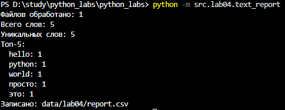 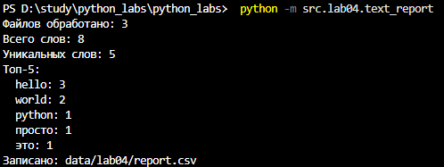 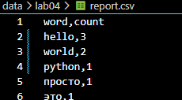

тест А 
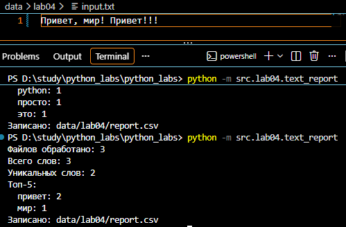 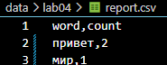

тест B 
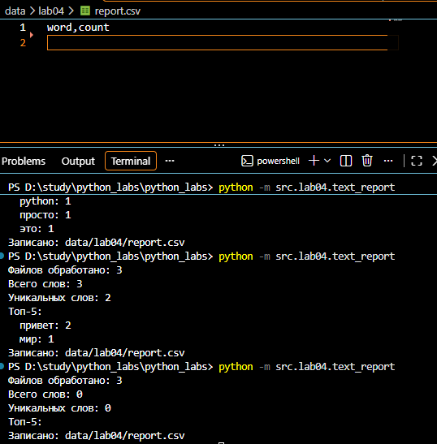

# Лабораторная работа 5
## задание 1: json_csv.py
```python

```
!

# Лабораторная работа 6
## техническое задание

# Лабораторная работа 7
##

# Лабораторная работа 8
##

# Лабораторная работа 9
##

# Лабораторная работа 10
##